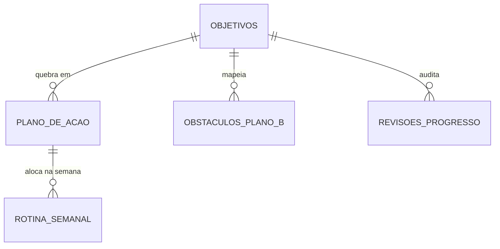

# Matrix Planner - Assistente de Planejamento com Habilidades de IA

Sistema de planejamento com habilidades reutilizáveis e base de dados estruturada para transformar qualquer objetivo (estudo, carreira ou negócio) em execução real dentro da rotina que a pessoa de fato tem.

---

## 1. O Problema que Resolve e o Diferencial

Quase todo plano montado em chat comum de IA quebra na segunda semana por dois motivos simples:
1. A IA gera cronogramas bonitos onde 100% do tempo livre vira tarefa, sem folga nenhuma para atraso ou cansaço.
2. Modelos padrão costumam puxar o saco do usuário dizendo "excelente meta!" para objetivos vagos e prazos impossíveis.

O diferencial deste projeto foi aplicar os princípios reais do meu protocolo **Matrix Breaker** e da estrutura do **EBI$U** diretamente no planejamento:
- **Mesa com três papéis opostos:** nas etapas abertas de decisão, três perfis fixos batem de frente (**Destruidor**, **Construtor Selvagem** e **Calibrador**) para cortar fantasia antes de ir para a agenda.
- **Zero puxa-saquismo:** proibido elogiar meta sem entrega clara ou agenda que não fecha no relógio.
- **Veto Soberano:** a IA propõe os caminhos e para em cada etapa esperando a minha decisão.
- **Tribunal Fênix em turno separado:** antes do Dia 1, uma habilidade extra só ataca o próprio plano para achar onde ele quebra numa semana ruim, sem poder reconstruir na mesma resposta.

---

## 2. Ferramentas Usadas e Por Que Escolhi Cada Uma

Eu não uso Notion nem ChatGPT no meu dia a dia. Trabalho direto com **Claude** e **Gemini**. Por isso, montei o assistente para rodar de verdade nas ferramentas que eu uso, sem depender de plataforma fechada:

- **Claude (Projetos / Artefatos) e Gemini (Gems):** é onde carrego o protocolo principal e as 6 habilidades no contexto fixo, sem precisar reexplicar o método a cada conversa nova.
- **Protocolo em JSON ([protocolo/MATRIX_PLANNER_v1.json](protocolo/MATRIX_PLANNER_v1.json)):** trava o comportamento dos modelos, define as leis da mesa e cria comandos de correção caso a IA tente correr ou amolecer o tom.
- **Base em Markdown + JSON ([planner/](planner/ESTRUTURA_PLANNER.md)):** mantém exatamente a mesma lógica relacional das 5 bases do Notion (chaves, ligações entre tabelas, fórmulas e status), mas em texto aberto versionável no GitHub e legível direto pelo Claude e pelo Gemini.

---

## 3. Instruções e Regras Aplicadas

As leis gravadas em [protocolo/MATRIX_PLANNER_v1.json](protocolo/MATRIX_PLANNER_v1.json) impedem o assistente de cair em resposta genérica:

1. **Anti-Sycophancy:** proibido aprovar meta sem critério objetivo de término ou semana sem margem de segurança.
2. **Selo de Identidade:** reimpressão do cabeçalho da mesa em toda resposta para a IA não perder os três personagens em conversas compridas.
3. **Regra da Sala de Cinema (Divergente vs. Convergente):** conflito entre os três personagens só roda em decisões abertas (definir escopo, escolher rota, prever obstáculos, Tribunal Fênix). Na hora de distribuir horas na rotina, entra conta seca e direta, sem teatro.
4. **Separação de Turnos:** o Tribunal Fênix ataca o plano num turno isolado. Atacar e consertar no mesmo turno vira "Teatro do Fênix" e invalida a resposta.
5. **Comandos de correção em tempo real:**
   - `REINICIAR FASE` - descarta resposta rasa estilo "Google de luxo" e obriga refazer com rigor.
   - `ERRO 403: VETO SOBERANO IGNORADO. Delete a etapa seguinte e aguarde em Standby.` - barra a IA se ela pular a minha pausa de aprovação.
   - `CANDURA RADICAL VIOLADA. Destruidor, assuma a mesa.` - corta elogio vazio e puxa de volta para análise seca.

---

## 4. Estrutura do Planner (Bases de Dados, Propriedades e Relações)

O Planner separa direção, execução, horário livre, plano B e revisão semanal em **5 bases conectadas** (campos e tipos completos em [planner/ESTRUTURA_PLANNER.md](planner/ESTRUTURA_PLANNER.md)):



| Base | Para que serve | Propriedades e ligações principais |
| :--- | :--- | :--- |
| **`Objetivos`** | Cravar entrega final, prazo e o que fica de fora | `id`, `nome`, `categoria`, `prazo_final`, `teto_semanal_horas`, `criterio_sucesso`, **`nao_escopo`**, `status` |
| **`Plano de Ação`** | Quebrar o alvo em blocos pequenos (0,5h a 3h) | `id`, `objetivo_id` (`-> Objetivos`), `fase`, `tarefa`, `dependencia`, `esforco_estimado_h`, `definicao_pronto`, `prioridade`, `status` |
| **`Rotina Semanal`** | Encaixar na agenda real deixando 20% de margem | `id`, `semana`, `dia_semana`, `turno_horario`, `horas_livres_h`, `tarefa_id` (`-> Plano de Ação`), `carga_alocada_h`, **`margem_imprevisto`**, `executado_h` |
| **`Obstáculos & Plano B`** | Evitar que um imprevisto trave a semana inteira | `id`, `objetivo_id` (`-> Objetivos`), `obstaculo`, `probabilidade`, `impacto`, **`gatilho_alerta`**, **`plano_b`** |
| **`Revisões de Progresso`** | Auditar viabilidade antes do Dia 1 e checar a semana | `id`, `objetivo_id` (`-> Objetivos`), `tipo` (*Tribunal Fênix* / *Check-in*), `horas_planejadas`, `horas_executadas`, `taxa_aderencia_pct`, `causa_raiz_desvio`, `ajuste_proxima_semana` |

---

## 5. Catálogo das 6 Habilidades

| # | Habilidade | Modo | O que faz na prática | Arquivo |
| :---: | :--- | :--- | :--- | :--- |
| **01** | **Esclarecer Objetivo** | Divergente | Demole desejos vagos, traz 3 recortes concretos e fecha prazo, prova de entrega e Não-Escopo | [01-esclarecer-objetivo.md](skills/01-esclarecer-objetivo.md) |
| **02** | **Montar Plano de Ação** | Divergente e Poda | Desenha 3 rotas diferentes, dá nota com Dose Mínima Efetiva, corta as fracas e gera tarefas | [02-montar-plano-acao.md](skills/02-montar-plano-acao.md) |
| **03** | **Adaptar à Rotina** | Convergente | Soma horas livres descontando 20% de margem e só encaixa o que realmente cabe no relógio | [03-adaptar-rotina.md](skills/03-adaptar-rotina.md) |
| **04** | **Antecipar Obstáculos** | Divergente | Lista travas reais da rotina e cria gatilho de alerta + Plano B de 15 minutos | [04-antecipar-obstaculos.md](skills/04-antecipar-obstaculos.md) |
| **05** | **Tribunal Fênix** *(Extra)* | Turno Isolado | Ataca o plano pronto antes do Dia 1 buscando no mínimo 3 pontos onde ele pode quebrar | [05-tribunal-fenix-viabilidade.md](skills/05-tribunal-fenix-viabilidade.md) |
| **06** | **Revisar Progresso** | Híbrido | Faz conta fria do que foi cumprido na semana, aponta a causa real do atraso e recalibra | [06-revisar-progresso.md](skills/06-revisar-progresso.md) |

---

## 6. Demonstração Prática (Dados Fictícios)

Para mostrar o método rodando sem expor nenhum dado pessoal nem objetivo real meu, rodei um caso de teste fictício completo em [demo/DEMONSTRACAO_PRATICA.md](demo/DEMONSTRACAO_PRATICA.md) (base salva em [planner/exemplo_ficticio.json](planner/exemplo_ficticio.json)):

- **Cenário do teste:** alguém com trabalho presencial de 44h por semana e apenas **6 horas brutas livres na semana** querendo *"aprender automação com IA para mudar de área"*.
- **O que aconteceu na sequência das habilidades:**
  1. A **Habilidade 01** cortou a ideia vaga e cravou um alvo concreto: publicar 2 automações práticas com IA no GitHub em 8 semanas, deixando explicitamente de fora criar site pago ou estudar teoria pesada agora.
  2. A **Habilidade 02** descartou teoria longa (nota 4) e código do zero (nota 3), escolhendo fluxo reverso por entrega real (nota 9) em 5 blocos (`T-01` a `T-05`).
  3. A **Habilidade 03** recusou a tentativa do teste de empurrar `6h` cheias de estudo na semana: travou `1h` de folga no sábado e deixou apenas **`5h` úteis alocadas**.
  4. A **Habilidade 04** mapeou 4 travas concretas (como ficar mais de 25 minutos preso num erro de JSON -> trocar na hora por dado fixo `mock`).
  5. A **Habilidade 05 (Tribunal Fênix)** acusou antes do Dia 1 que a tarefa `T-04` (`12h` direto) quebraria por perda de contexto, levando ao fatiamento em blocos menores de `2,5h`.
  6. A **Habilidade 06 (Semana 1)** apurou `3,5h` feitas de `5,0h` planejadas (`70%`), mostrou que o atraso do sábado veio por ignorar o gatilho dos 25 minutos e manteve o teto de `5h` na Semana 2 sem dobrar carga.

---

## 7. Como Usar no Claude ou Gemini

1. Abra um **Projeto no Claude** ou crie um **Gem no Gemini**.
2. Cole [protocolo/MATRIX_PLANNER_v1.json](protocolo/MATRIX_PLANNER_v1.json) nas instruções do projeto junto com os arquivos de `skills/`.
3. Anexe um arquivo JSON no formato de [planner/exemplo_ficticio.json](planner/exemplo_ficticio.json) (limpo para o novo objetivo).
4. Envie a meta bruta pedindo para rodar a **Habilidade 01** e avance dando seu `ok` ou veto a cada pausa.

---

## 8. Estrutura do Repositório

```text
├── demo/
│   └── DEMONSTRACAO_PRATICA.md              # Teste completo das 6 habilidades com dados fictícios
├── planner/
│   ├── ESTRUTURA_PLANNER.md                 # Modelagem das 5 bases, propriedades e relações
│   └── exemplo_ficticio.json                # Exemplo preenchido com dados fictícios para Claude e Gemini
├── protocolo/
│   └── MATRIX_PLANNER_v1.json               # Regras da mesa, selo de identidade, separação de turnos e correções
├── skills/
│   ├── 01-esclarecer-objetivo.md
│   ├── 02-montar-plano-acao.md
│   ├── 03-adaptar-rotina.md
│   ├── 04-antecipar-obstaculos.md
│   ├── 05-tribunal-fenix-viabilidade.md
│   └── 06-revisar-progresso.md
└── README.md
```

---

## Autor

**Hamilton de Oliveira Castro**  
Empresário | Ex-Atleta Profissional de Basquete | Arquiteto de Soluções com IA | [#MatrixBreaker](https://x.com/search?q=%23MatrixBreaker&src=hashtag_click)

> *"Nem positivo. Nem negativo. Apenas interpretativo."*

Trajetória construída na disciplina do esporte de alto rendimento e na rotina prática de negócios. Estudante de **Produção Criativa com IA na Faculdade Estácio**, focado em aplicar IA e engenharia de sistemas para tirar ideias do papel com eficiência real e sem puxa-saquismo de máquina.
