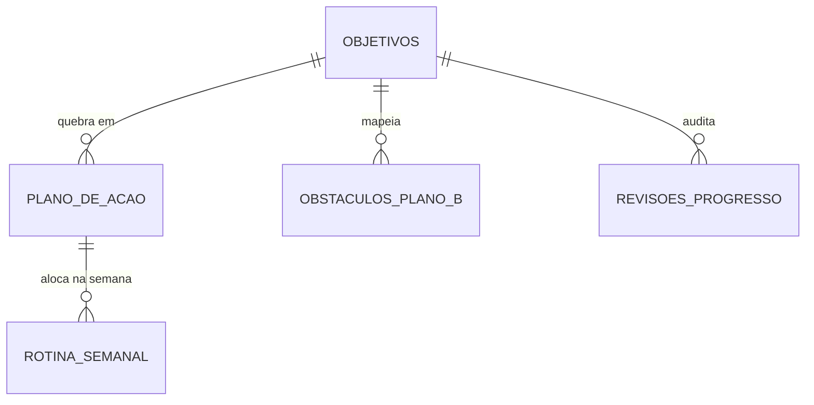

# Estrutura do Planner - Modelagem das 5 Bases

A memória do assistente usa **5 bases conectadas**. Eu mantenho o esquema compatível com a estrutura relacional do Notion (tabelas, relações, fórmulas e seleções), mas opero tudo em arquivos abertos (**Markdown + JSON** em `planner/exemplo_ficticio.json`), porque no dia a dia trabalho direto no **Claude** e no **Gemini** sem usar Notion nem ChatGPT.

Se outra pessoa quiser subir exatamente esse desenho para o Notion, os campos e relações batem um a um.

## Mapa das Relações

---

## 1. Base `Objetivos`
Guarda o alvo fechado e a lista do que está proibido entrar no meio do caminho (**Não-Escopo**).

| Propriedade | Tipo | Obrigatória? | Para que serve |
| :--- | :--- | :---: | :--- |
| `id` | Texto / ID | Sim | Código curto do objetivo (ex.: `OBJ-01`). |
| `nome` | Título | Sim | Ação + entrega concreta. |
| `categoria` | Seleção | Sim | `Estudo`, `Carreira` ou `Negócio`. |
| `prazo_final` | Data | Sim | Limite exato de semanas ou data fechada. |
| `teto_semanal_horas` | Número | Sim | Horas brutas livres por semana. |
| `criterio_sucesso` | Texto | Sim | Prova binária (`SIM/NÃO`) para checar no fim do prazo. |
| `nao_escopo` | Texto | Sim | O que fica de fora para não perder foco. |
| `status` | Seleção | Sim | `Rascunho`, `Em Execução`, `Pausado` ou `Concluído`. |

---

## 2. Base `Plano de Ação`
Quebra o objetivo aprovado em blocos pequenos de entrega.

| Propriedade | Tipo | Obrigatória? | Para que serve |
| :--- | :--- | :---: | :--- |
| `id` | Texto / ID | Sim | Código da tarefa (`T-01`, `T-02`). |
| `objetivo_id` | Relação (`-> Objetivos`) | Sim | Liga a tarefa ao objetivo certo. |
| `fase` | Seleção / Texto | Sim | Etapa macro do projeto. |
| `tarefa` | Título | Sim | Ação iniciada por verbo (blocos de `0,5h` a `3h`). |
| `dependencia` | Relação / Texto | Não | Tarefa anterior obrigatória. |
| `esforco_estimado_h` | Número | Sim | Estimativa honesta para validar na rotina. |
| `definicao_pronto` | Texto | Sim | Artefato que comprova que terminou. |
| `prioridade` | Seleção | Sim | `P1 Crítica`, `P2 Importante`, `P3 Opcional`. |
| `status` | Seleção | Sim | `A Fazer`, `Em Andamento`, `Concluído`, `Cortado`. |

---

## 3. Base `Rotina Semanal`
Cruza o tamanho das tarefas com os horários livres da semana, travando `20%` de folga para imprevisto.

| Propriedade | Tipo | Obrigatória? | Para que serve |
| :--- | :--- | :---: | :--- |
| `id` | Texto / ID | Sim | Identificador do turno (ex.: `ROT-S1-TER`). |
| `semana` | Texto / Número | Sim | Semana do plano (`Semana 1`, `Semana 2`). |
| `dia_semana` | Seleção | Sim | `Segunda` a `Domingo`. |
| `turno_horario` | Texto | Sim | Janela exata (`20h00-21h30`). |
| `horas_livres_h` | Número | Sim | Tempo real livre naquela janela. |
| `tarefa_id` | Relação (`-> Plano de Ação`) | Condicional | Qual tarefa entra ali (fica vazio no bloco de margem). |
| `carga_alocada_h` | Número | Sim | Horas marcadas para trabalhar no plano. |
| `margem_imprevisto` | Checkbox | Sim | Marca a reserva protegida de segurança. |
| `executado_h` | Número | Sim | Preenchido no check-in semanal. |

---

## 4. Base `Obstáculos & Plano B`
Deixa os planos de contingência prontos antes de a primeira semana difícil acontecer.

| Propriedade | Tipo | Obrigatória? | Para que serve |
| :--- | :--- | :---: | :--- |
| `id` | Texto / ID | Sim | Identificador (`OBS-01`). |
| `objetivo_id` | Relação (`-> Objetivos`) | Sim | Objetivo protegido. |
| `obstaculo` | Título | Sim | Problema concreto que costuma travar a rotina. |
| `probabilidade` | Seleção | Sim | `Alta`, `Média` ou `Baixa`. |
| `impacto` | Seleção | Sim | `Alto`, `Médio` ou `Baixo`. |
| `gatilho_alerta` | Texto | Sim | Sinal claro que dispara a mudança de rota. |
| `plano_b` | Texto | Sim | Ação curta (`15 min`) para não abandonar a semana. |

---

## 5. Base `Revisões de Progresso`
Guarda o ataque do Tribunal Fênix antes do Dia 1 e os fechamentos de cada semana.

| Propriedade | Tipo | Obrigatória? | Para que serve |
| :--- | :--- | :---: | :--- |
| `id` | Texto / ID | Sim | Identificador (`REV-00-FENIX`, `REV-S01`). |
| `objetivo_id` | Relação (`-> Objetivos`) | Sim | Objetivo auditado. |
| `tipo` | Seleção | Sim | `Tribunal Fênix (Pré-Dia 1)` ou `Check-in Semanal`. |
| `periodo` | Texto | Sim | `Pré-Execução`, `Semana 1`, etc. |
| `horas_planejadas` | Número | Condicional | Carga prevista da semana. |
| `horas_executadas` | Número | Condicional | Horas que realmente saíram do papel. |
| `taxa_aderencia_pct` | Fórmula (`%`) | Condicional | `(horas_executadas / horas_planejadas) x 100`. |
| `causa_raiz_desvio` | Texto | Sim | O que de fato deu errado, sem desculpa. |
| `ajuste_proxima_semana` | Texto | Sim | O que corta, fatia ou recalibra na semana seguinte. |
